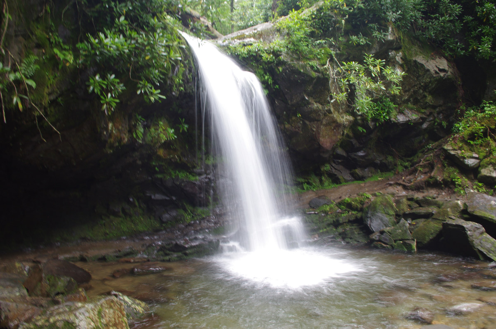
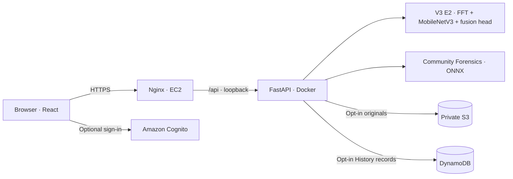

<h1 align="center">Image Origin Studio</h1>

**A transparent workspace for exploring where an image may have come from.**

Compare two independent model suggestions, inspect the pixels each model sees, check embedded Content Credentials, and keep selected analyses in private History.

[Live site](https://35.154.237.144/) · [Run locally](#run-it-locally) · [How it works](#how-it-works) · [Documentation](docs/README.md)

    

> **A screening tool, not a provenance verdict.** Model scores are suggestions from fixed decision rules. A C2PA credential is a separate signed claim about a file. Neither a model score nor the absence of a credential proves how an image was made.

## Explore the product

| Analyze | Gallery | History |
| --- | --- | --- |
| Upload up to eight images and compare **V3 E2**, **Community Forensics**, or both. See each model's score, cutoff, version, timing, and errors independently. | Guess the origin of eight source-documented cases before revealing the source record and both model suggestions. The cases include disagreements and mistakes. | Sign in with Cognito, explicitly opt in to saving an analysis, reopen the exact original and result snapshot, or delete saved items. |

The analysis screen also offers an on-demand view of each model's input image, a browser-side Content Credentials check against the **original bytes**, CSV export, and per-image JSON or print-friendly case reports. The gallery is a curated demonstration, **not an accuracy test**. Its [source manifest](docs/GALLERY_MANIFEST.json) records provenance, rights, transformations, hashes, and pinned model runs.

| Documented camera photograph | Generated image |
| :---: | :---: |
|  |  |
| [USGS source and credit](docs/GALLERY_CAMERA_SOURCES.md) | [COCOXGEN source and CC BY 4.0 credit](docs/GALLERY_PUBLIC_AI_SOURCES.md) |

## Live deployment

Image Origin Studio went live on **29 October 2026** at **[https://35.154.237.144/](https://35.154.237.144/)**. The public HTTPS site and `/api/health` were reachable; model analysis, Cognito sign-in, and an image saved to History were also confirmed. The address is an Elastic IP rather than a custom domain. Live availability may change if the trial is stopped or the IP is released.

The deployment runs in AWS **Asia Pacific (Mumbai), `ap-south-1`**: one Ubuntu EC2 host serves the React build through Nginx and HTTPS; Nginx proxies `/api` to a Dockerized FastAPI process bound to loopback. Cognito provides hosted sign-in. Explicitly saved originals go to a private S3 bucket and History metadata and quotas go to DynamoDB. An EC2 instance role supplies AWS access without static keys on the host. The [deployment guide](docs/DEPLOYMENT.md) explains the topology, settings, checks, and operating tasks.

This is a small public deployment, not a claim of production-scale reliability. Successful sign-in and saving have been confirmed; a completed second-account isolation test, a verified budget alert, and inspection of the installed certificate-renewal schedule have not been recorded. Those checks are tracked in the [deployment guide](docs/DEPLOYMENT.md#remaining-release-and-operations-checks).

## How it works



The browser sends each selected image to the API. The API validates its bytes, format, dimensions, and size, then runs the requested model pipelines one at a time. If one model fails, the other can still return its result. No training occurs during a request. The frontend generates reports and performs the C2PA check separately; it does not combine the two model scores into one verdict. [Architecture and data flow →](docs/ARCHITECTURE.md)

| Model | What runs | AI flagging rule | Ownership |
| --- | --- | --- | --- |
| **V3 E2** | 64 FFT features plus 848 features from a frozen, ImageNet-pretrained MobileNetV3-Small backbone; an owner-trained fusion head and fitted scalers are packaged in [`v3_e2.npz`](backend/artifacts/README.md). | AI score **≥ 0.50** | Owner-trained head; TorchVision pretrained backbone is downloaded separately and hash-checked. |
| **Community Forensics** | The pinned [Thermostatic ONNX baseline](https://huggingface.co/Thermostatic/community-forensics-frontier-detector-2026-08), revision `16db135220b318d811b207db576d90368980b595`. | AI score **≥ 0.65**, following its published cutoff. | External model, credited under its own MIT terms; weights are downloaded and hash-checked. |

The models have different training histories and preprocessing. Their displayed scores are **not calibrated probabilities for arbitrary uploads**, and a higher score from one model does not rank it above the other. V3 E2's historical 92% final-set result and Community Forensics' 85% app screening result used different samples and cannot be compared head to head. A [12-image paired pilot](docs/PUBLIC_PILOT_2026-10-24.md) shows concrete errors on the same files but is too narrow for a general performance claim. See the [evaluation index](docs/README.md#evaluation-and-source-evidence) for methods and limits.

## Privacy and saved History

Guest use needs no account. Every upload reaches the hosted API for analysis, but the application does **not add guest or unsaved analyses to History**. A signed-in user must select **Save this analysis to my history** for each batch. Saved items contain the unmodified original, including any embedded metadata, and a snapshot of the result. The current rules are **30-day expiry**, **10 items or 50 MiB per identity**, and **500 MiB of saved originals across all identities**. Deletion and expiry make an item unreadable before background cleanup removes its storage objects.

The local development mode uses SQLite and ignored files; hosted mode uses S3 and DynamoDB. Local test identities are deliberately loopback-only and disabled by default. For details, including what is and is not verified on the live host, read [Architecture and data flow](docs/ARCHITECTURE.md#history-and-data-lifecycle) and the [deployment guide](docs/DEPLOYMENT.md).

## Run it locally

**Prerequisites:** Windows PowerShell, Python 3.12, Node.js with npm, and internet access for the first download of each model's pinned weights. Start in the repository root. The Python lockfile targets Python 3.12; the frontend lockfile pins the npm tree.

**Terminal 1 — API**

```powershell
py -3.12 -m venv .venv
.\.venv\Scripts\python.exe -m pip install --upgrade pip
.\.venv\Scripts\python.exe -m pip install -r backend\requirements-lock.txt
$env:PYTHONPATH = "backend"
$env:HF_HOME = (Join-Path (Get-Location) "model-cache")
Remove-Item Env:IOS_LOCAL_TEST_AUTH -ErrorAction SilentlyContinue
.\.venv\Scripts\python.exe -m uvicorn app.main:app --host 127.0.0.1 --port 8001
```

**Terminal 2 — frontend**

```powershell
cd frontend
npm ci
npm run dev
```

Open the URL Vite prints, usually `http://127.0.0.1:5173`. Its development proxy sends `/api` requests to `http://127.0.0.1:8001`. The first real analysis may take longer while weights download and load. Press **Ctrl+C** in both terminals to stop.

Local History can be reviewed with disposable Alice/Bob identities by restarting the API with `$env:IOS_LOCAL_TEST_AUTH = "1"` before the `uvicorn` command. This switch works only on loopback and is **not** a hosted account system. Keep it unset for ordinary local use. See [Local History verification](docs/HISTORY_LOCAL_VERIFICATION_2026-10-25.md) and [Developer checks](#developer-checks).

## Developer checks

From the repository root after installing the dependencies above:

```powershell
$env:PYTHONPATH = "backend"
.\.venv\Scripts\python.exe -m pytest backend\tests -q
.\.venv\Scripts\python.exe -m ruff check backend
.\.venv\Scripts\python.exe scripts\verify_gallery_manifest.py
cd frontend
npm run format:check
npm run build
```

API tests use stub detectors for fast validation and route checks. They do not establish real-model accuracy. For an actual pinned-model smoke run and container checks, follow [Architecture and data flow](docs/ARCHITECTURE.md#verification) and the [dated AWS readiness record](docs/AWS_READINESS_2026-10-26.md). The current cloud adapter has unit tests, while the [live-host checklist](docs/DEPLOYMENT.md#remaining-release-and-operations-checks) tracks checks that still need direct evidence.

## Repository map

```text
backend/    FastAPI, inference pipelines, local and AWS History, tests, model artifact
frontend/   React UI, browser-side C2PA and reports, curated gallery assets
infra/      Parameterized Nginx and IAM deployment templates
scripts/    Packaging, parity, gallery, and measurement utilities
docs/       Current guides, dated implementation records, evaluation, source evidence
output/     Historical local review captures and example report artifacts
```

Start at the [documentation index](docs/README.md) for the current architecture, deployment, evaluation, source credits, and dated project records.

## License and credits

The project-owned application code, documentation, and packaged V3 E2 fusion artifact are released under the [MIT License](LICENSE), as chosen by the owner. The downloaded TorchVision backbone and Community Forensics weights remain under their upstream terms and are **not** relicensed by this repository. Gallery images retain their separate source rights and attribution; see [third-party notices](THIRD_PARTY_NOTICES.md) and the [gallery source records](docs/GALLERY_MANIFEST.json).
